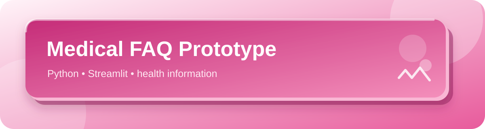

<p align="center"></p>

<p align="center">
  
  
</p>

# Medical FAQ Prototype

A small Streamlit project for exploring basic health-question routing and FAQ lookup.

## What it demonstrates

- A text-input interface for health questions.
- Routing between an FAQ lookup and a symptom-checking path.
- A clear reminder to seek qualified care for medical concerns.

## Run locally

The repository includes `app.py` and a dependency file named `requirements`:

```bash
python -m pip install -r requirements
streamlit run app.py
```

Review the project dependencies and data files before running; this repository is an educational prototype, not a validated clinical tool.

## Safety

This project cannot diagnose, treat, or rule out a condition. It is not a substitute for professional medical care. Do not use it for emergencies or medication decisions; contact a qualified healthcare professional or local emergency service when needed.

---

<p align="center">More work: <a href="https://github.com/Anuuuuuuu18">github.com/Anuuuuuuu18</a> · Made with care in pink 🎀</p>
